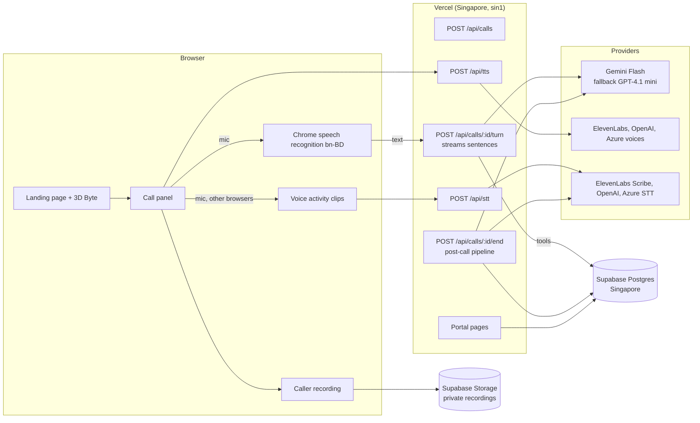

# ByteVoice Bangla

An AI phone receptionist for Bangladeshi dental clinics. It speaks natural, everyday Bangladeshi Bangla, books, reschedules and cancels appointments, answers clinic questions, refuses medical advice and off-topic chat, and puts every call into a staff portal.

Built by **Sharif Mohammad Omar Faruq** for the StrategyByte AI Engineer task (November 2026).

| | Link |
|---|---|
| Landing page with the live Bangla caller | https://bytevoice-bangla-five.vercel.app |
| Staff portal | https://bytevoice-bangla-five-portal.vercel.app |
| Repository | https://github.com/IKARUSops/3D-conversational-AI |
| Video overview (3 min) and portal logins | in the submission email |

---

## 1. How to review (5 minutes)

1. Open the landing page in **Chrome on a computer**, ideally with **headphones**.
2. Press **"বাংলা কলারের সাথে কথা বলুন"** (Talk to our Bangla caller), allow the microphone, and talk to Nadia.
3. Log in to the portal with the reviewer account from the email. Your call appears in the calls list a few seconds after you hang up.

**Testing tips**

- When Nadia asks for the phone number, **say each digit separately**, for example "শূন্য এক সাত এক দুই ...". Do not say "ডাবল ছয়" or "double six". Nadia understands "double", but single digits are the most reliable with browser speech recognition. Pause for a second after the last digit.
- Wait for Nadia to finish her question before you answer. You can also interrupt her on purpose: she stops at once.
- No microphone, or testing with an automated agent? Use **"মাইক ছাড়া লিখে কথা বলুন"** (type instead of speaking) in the call panel.
- Many test calls from one network: use the review link from the email (`?key=...`). It skips the limit of 30 calls per network per hour.
- Use fake names and numbers. Mobile numbers must be 11 digits starting with 01.

**Portal accounts**

| Account | What it can do |
|---|---|
| Reviewer (`...+reviewer@gmail.com`) | Admin view of everything, **read only**: calls, transcripts, recordings, appointments, callbacks, data model and the Settings page with the API keys section. It cannot change data. |
| Receptionist (`...+reception@gmail.com`) | Daily clinic work: calls, appointments, callbacks (mark done). It does **not** see Settings. |

**Why you may not see the API keys (BYOK).** The Settings page, where a clinic adds its own provider keys, is for admins only. The receptionist account does not show it. The reviewer account shows it in read-only mode, so reviewers can see it but cannot change the keys. To edit keys, the clinic owner turns off read-only for an admin: in Supabase, open Table Editor, then `staff_users`, set `read_only` to false on that row, add the keys in the portal, then set `read_only` back to true.

**Credits note.** Credits are low right now. Everything except the OpenAI language model runs on free tiers. Each service has a fallback, so the system keeps working, but quality and speed drop when a fallback is active (for example, a different voice, or slower replies).

---

## 2. What the task asked, and where it is

| Requirement (brief) | Where to see it |
|---|---|
| Landing page, at least 3 sections, hero says ByteVoice is in Bangladesh | Landing: hero, How it works, Features, Use cases, Pricing, Contact |
| 3D element or mascot in the hero (plus) | Byte, a 3D mascot made in Blender with 4 animated states (idle, listening, thinking, speaking) that follow the live call |
| Bilingual page (plus) | বাংলা / EN toggle in the header |
| "Talk to our Bangla caller" in the hero, in the browser, with connecting, live and ended states and mic errors handled | Gold button in the hero; call panel shows each state; mic denied, unsupported browser and provider fallback have clear messages |
| Natural Bangladeshi Bangla, not Kolkata | System prompt with Dhaka wording (জি, বলেন, পানি; never নমস্কার, জল); voice instructions for a Dhaka accent |
| Greeting, name confirmed, phone read back digit by digit | Every booking call; the code reads the number back from digits |
| Reason, preferred date and time ("next Sunday evening") | Date words are turned into real dates by code, not by the LLM |
| Book, reschedule, cancel (book in one call, cancel in a later call) | Tools `book_appointment`, `reschedule_appointment`, `cancel_appointment`; identity by confirmed phone |
| Out-of-scope, irrelevant and medical questions | Off-topic: one polite line, then ends after 3 (status **Spam**). Medical: no advice, staff callback. Emergency: hospital or 999, urgent callback |
| Interruptions and turn-taking | Barge-in stops the voice within about 300 ms; echo filter; one question per reply |
| Confirmation before booking, no invented information | Booking needs a yes to a full read-back; clinic facts come only from the database |
| Portal: call list (date, time, caller, duration, status), search and filters | Calls page: search by name or phone, filter by status, dates, speech and voice provider |
| Per-call view: extracted fields, transcript with speakers and times, status | Call detail: fields with confidence, live and re-transcribed transcript, English translation, tool timeline, recording |
| Status: booked, enquiry, follow-up needed, incomplete, failed | Plus rescheduled, cancelled and spam. Set by rules in code after the call |
| Login with reviewer details | Supabase Auth; logins in the email |
| Structured data model (plus) | 16 tables, see section 5 and the **Data model** page in the portal |
| Secrets handled correctly | No keys in git; server-only modules; BYOK keys encrypted with AES-256-GCM |
| Keep everything live | Supabase keep-alive: UptimeRobot, a GitHub Action every 6 hours and a daily Vercel cron |

---

## 3. Architecture

**One turn of the call.** The browser sends the caller's words. The server streams the LLM reply sentence by sentence, and each sentence goes to the voice provider at once, so Nadia starts speaking before the whole reply is ready (first token about 0.8 to 2 seconds). The LLM can call tools; tools run in code and write to the database.

**The LLM talks, code decides.** Dates ("আগামী রবিবার সন্ধ্যায়"), phone checks, opening hours, Friday closing, the prayer break, free slots, booking rules and the final call status are all deterministic code with tests. The database has a partial unique index, so the same doctor and slot can never be booked twice, even by two calls at once.

**After the call.** The caller's recording is re-transcribed with a batch speech model (more accurate than the live one), an LLM extracts structured fields (values the tools already confirmed always win), turns are translated to English, and rules set the status. This takes about 10 to 20 seconds.

**Fallbacks.** Speech-to-text, voice and LLM each have a chain. A provider that fails, or gives no first audio within 4 seconds, is replaced by the next one. A provider that rejects the account (401, 402, 403) is skipped for 10 minutes, and the browser keeps the voice that worked for the rest of the call. Every fallback is logged and shown in the call's timeline.

---

## 4. Main decisions and trade-offs

| Decision | Why | Trade-off |
|---|---|---|
| STT, LLM and TTS pipeline instead of one speech-to-speech model | We can pick the best Bangla model for each step, swap providers, and give the LLM tools and rules | More moving parts; latency kept low by streaming sentences |
| Live STT in the browser (Chrome Web Speech, bn-BD) | Best Bangla accuracy in my own tests, free, no audio upload per turn | Chrome only; other browsers use server STT on short clips |
| Gemini Flash as the main LLM, GPT-4.1 mini as fallback | Fast first token, good Bangla, structured tool calls | Free tier limits; fallback costs money |
| ElevenLabs voice first, then OpenAI, then Azure | ElevenLabs sounded most natural; Azure Bangla sounded robotic in tests | Free ElevenLabs quota is small; library voices need a paid plan, so a built-in voice is used |
| Supabase (Postgres, Auth, Storage) in Singapore | Relational data fits calls, patients and appointments; close to Dhaka | Free projects pause after 7 days idle, so three keep-alive layers |
| One Vercel project, two domains | Landing and portal links as asked, one codebase | The landing domain also serves `/portal` |
| Bring your own keys (BYOK) per clinic, encrypted | A real clinic pays for its own usage | Key management UI is admin-only |
| Headphones recommended | No echo cancellation can fully stop the agent hearing itself on speakers | Documented as a limitation |

The full log of decisions, including each fix from real test calls, is in [`docs/DECISIONS.md`](docs/DECISIONS.md).

---

## 5. Data model

16 tables in Postgres (Prisma schema: [`prisma/schema.prisma`](prisma/schema.prisma)). The portal's **Data model** page draws them with their relations.

| Table | Holds |
|---|---|
| `clinics` | Clinic profile and settings (hours, Friday closed, prayer break, lead time) |
| `doctors`, `doctor_schedules` | Doctors, specialty and weekly hours |
| `services` | Check-up, scaling, filling, root canal, extraction, braces, X-ray, with fees and the specialty needed |
| `patients` | One per clinic and phone (E.164), Bangla and English name |
| `calls` | One per call: times, duration, language, providers used, status, end reason, recording path, agent state |
| `transcript_turns` | Every turn, live and re-transcribed, with speaker, start time, Bangla text and English translation |
| `call_extractions` | Structured fields per call with a confidence per field |
| `appointments`, `appointment_history` | Bookings and every change (created, rescheduled, cancelled) with the call that made it |
| `callbacks` | Staff follow-ups with category (medical, urgent, billing, complaint, human request) and priority |
| `call_events` | Timeline: every tool call and result, fallback, interruption, silence prompt, latency |
| `staff_users` | Portal users, role, read-only flag |
| `provider_keys` | BYOK keys, encrypted (AES-256-GCM) |
| `rate_limits`, `demo_requests` | Abuse limits and the landing contact form |

**Validation.** All text is NFC-normalised and Bangla digits (০ to ৯) are converted before parsing. Phone numbers must be 11-digit Bangladeshi mobiles (013 to 019), stored as E.164 (+8801...). Names said twice by speech recognition ("ওমর ওমর") are saved once. Every API input is checked with zod schemas shared by client and server ([`src/contracts`](src/contracts)). Row Level Security is on; the app uses server-side access only.

**Storage.** Database and recordings are in Supabase, region ap-southeast-1 (Singapore). Recordings are in a private bucket; the portal plays them through signed links that expire after 10 minutes. Only the caller's microphone is recorded.

---

## 6. Testing

- **289 automated tests** (Vitest), including full-call flows on an in-memory Postgres (PGlite): book, reschedule, cancel, callbacks, double-booking, dates, Bangla numbers, phone checks, echo filter, fallbacks and status rules. Run `pnpm verify` (typecheck, lint, tests, build).
- **Live test calls.** Each problem found in real calls was fixed and turned into a test. See [`docs/TEST-CASES.md`](docs/TEST-CASES.md): for example, a repeated booking tool call that told the caller "slot taken" (now idempotent per call), a short "ঠিক আছে" dropped by the echo filter, Chrome giving no final speech result, and stacked questions (now one question per reply, enforced in code).

---

## 7. How I used AI

I used Claude (Anthropic) as a pair engineer and Claude Code agents for parallel work. My part was the product and engineering decisions, and checking every result:

- **Research and tests before code.** I tested Bangla STT and TTS providers in a Colab notebook and a browser test page with my own voice, and picked providers from the results (section 4).
- **Specs first.** I wrote three requirement documents with AI help (product, engineering, 3D mascot) and used them to brief the coding agents ([`docs/`](docs)).
- **Parallel agents.** Separate agents built services, the agent loop, the call UI and the portal against shared zod contracts that I owned; I integrated and reviewed.
- **3D mascot.** Byte was modelled, rigged and animated in Blender through the Blender MCP, then exported as a compressed GLB.
- **Design skills.** A design system ([`docs/DESIGN.md`](docs/DESIGN.md)), UX copy in Bangla and English, and an accessibility review.
- **Real-call debugging.** I made live calls, read the transcripts and timelines, found the cause of each problem in the code, and decided the fix.

I can explain every part of the code, including what the agents wrote.

---

## 8. Known limitations (honest list)

- **Prototype.** The call-end screen shows a link to the portal so reviewers can jump to the record. A real clinic release would hide it from callers.
- **Low credits.** See the credits note in section 1. When fallbacks are active, the voice changes and replies can be slower.
- **Browser STT is Chrome only.** Other browsers use server STT on short clips, which is slower.
- **Headphones recommended.** On speakers, Nadia may hear her own voice; the echo filter reduces this but cannot remove it.
- **End of turn.** A long pause inside a phone number can end the caller's turn early; Nadia asks for the rest and joins the parts.
- **Free tiers** have daily limits; a daily cap of 300 calls protects the demo.
- **Recording** has the caller's microphone only, not Nadia's voice.

## 9. Future work

- A Bangladeshi phone number or WhatsApp calling, so callers use their phone and international call quality is no longer a problem.
- Smarter end-of-turn detection (semantic, not only silence), especially for phone numbers.
- SMS confirmation after booking.
- Paid voice tier for a consistent voice and lower latency.

---

## 10. Run it yourself

Requirements: Node 22, pnpm 10, a Supabase project (Singapore) and at least one LLM key.

1. `pnpm install`
2. Copy `.env.example` to `.env` and fill it in (comments explain each value). Never commit `.env`.
3. `pnpm db:deploy` (creates the tables, constraints and RLS)
4. `pnpm db:seed` (clinic, doctors, services, the `recordings` bucket and the two staff users)
5. `pnpm dev` and open http://localhost:3000. Health check: http://localhost:3000/api/health should show `"db":true`.

**Deploy on Vercel:** import the repo, build command `pnpm env:check && pnpm build`, add the env vars (not the seed-only ones), add a second domain for the portal and set `PORTAL_HOST` to it. Functions run in `sin1` (Singapore).

**Keep-alive:** set the GitHub repository variable `APP_URL` and the secret `CRON_SECRET` for [`.github/workflows/keepalive.yml`](.github/workflows/keepalive.yml), and add an UptimeRobot monitor on `/api/health`.

| Command | What it does |
|---|---|
| `pnpm dev` / `pnpm build` / `pnpm start` | Develop, build, run |
| `pnpm verify` | Typecheck, lint, unit tests and build |
| `pnpm test` / `pnpm e2e` | Unit tests / Playwright smoke tests |
| `pnpm db:deploy` / `pnpm db:seed` | Apply migrations / seed data |
| `pnpm env:check` | Fail if a required env var is missing |

## License

Copyright (c) 2026 Sharif Mohammad Omar Faruq. Licensed under the [PolyForm Noncommercial License 1.0.0](LICENSE): free for research, study and other noncommercial use; commercial use is not allowed without written permission. See [NOTICE.md](NOTICE.md).
